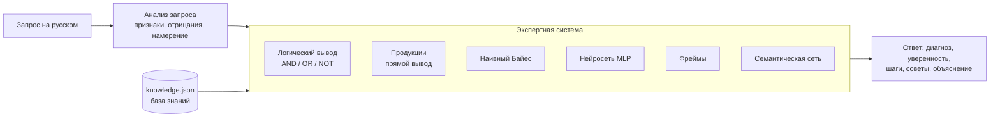

# PC Doctor — ИИ-помощник для диагностики неисправностей ПК

Семестровый проект по дисциплине «Искусственный интеллект».

Пользователь описывает проблему обычным языком («комп не включается и пахнет гарью»).
Помощник распознаёт признаки, ставит диагноз с оценкой уверенности, объясняет ход рассуждений,
при необходимости задаёт уточняющие вопросы и даёт шаги устранения.

В проекте реализованы все модели из курса — **база знаний, логический вывод, продукционные правила,
фреймы, семантическая сеть, вероятностный классификатор и нейронная сеть**. Всё написано на Python
с нуля, из внешних библиотек используется только `numpy`.

```
Вы: Компьютер иногда сам перезагружается, синего экрана нет
PC Doctor: Распознал признаки: самопроизвольные перезагрузки. Учту, что нет: синий экран (BSOD).
           Пока больше всего похоже на «Перегрев процессора» (43%), но нужно уточнить.
           Вопрос 1: Температура процессора выше 85 °C или корпус сильно горячий?
Вы: почему
PC Doctor: Сейчас наиболее вероятны: Перегрев процессора — 43%, Неисправность блока питания — 32% ...
           Ответ на вопрос лучше всего разделит эти гипотезы (максимальный прирост информации).
Вы: да
PC Doctor:  95.5%  Перегрев процессора   Байес 90% | нейросеть 97% | правила: логика, продукции
           Как устранить — чистка системы охлаждения и замена термопасты:
             1. Проверьте температуры программой HWMonitor или Core Temp. ...
```

## Быстрый старт

```bash
git clone https://github.com/ruhxmai/ai-pc-doctor.git
cd ai-pc-doctor
pip install -r requirements.txt     # только numpy

python main.py                      # меню со всеми модулями
python main.py chat                 # чат с ИИ-помощником
python main.py ask "не включается, вентиляторы не крутятся"
python main.py consult              # экспертная система сама задаёт вопросы
python main.py train                # пересоздать датасет и переобучить модели
python main.py test                 # 59 автотестов
```

Требуется Python 3.10+. Обученные модели уже лежат в `models/`; если их удалить, они переобучатся
при первом запуске (несколько секунд).

## Архитектура



Итоговая уверенность = **0.35 · Байес + 0.35 · нейросеть + 0.30 · правила** (логика и продукции).
Фреймы добавляют сведения о конкретных комплектующих пользователя (возраст, остаток ресурса),
семантическая сеть — признаки для дифференциальной диагностики. Следующий вопрос в консультации
выбирается по максимуму ожидаемого прироста информации.

## Соответствие плану семестра

| Неделя | Задание | Реализация | Демо | Отчёт |
|---|---|---|---|---|
| 4 | Репозиторий, предметная область, база знаний, семантическая сеть | [`knowledge_base.py`](pcdoctor/knowledge_base.py), [`knowledge.json`](data/knowledge.json), [`semantic_net.py`](pcdoctor/semantic_net.py) | `demos/week04_knowledge_base.py` | [week04](docs/weeks/week04.md) |
| 5 | Логическая модель, факты, правила, логический вывод | [`logic.py`](pcdoctor/logic.py), [`logic_kb.pl`](data/logic_kb.pl) | `demos/week05_logic.py` | [week05](docs/weeks/week05.md) |
| 6 | AND, OR, NOT, объяснение результата | [`logic.py`](pcdoctor/logic.py), [`explanation.py`](pcdoctor/explanation.py) | `demos/week06_logic_explain.py` | [week06](docs/weeks/week06.md) |
| 7 | Продукционная система, база правил, прямой вывод | [`production.py`](pcdoctor/production.py), [`production_rules.json`](data/production_rules.json) | `demos/week07_production.py` | [week07](docs/weeks/week07.md) |
| 8 | Фреймовая модель, объекты, свойства, связи, наследование | [`frames.py`](pcdoctor/frames.py), [`frames.json`](data/frames.json) | `demos/week08_frames.py` | [week08](docs/weeks/week08.md) |
| 9 | Программа работы с фреймами: поиск и изменение свойств | [`frames.py`](pcdoctor/frames.py), [`frames_cli.py`](pcdoctor/frames_cli.py) | `demos/week09_frames_program.py [-i]` | [week09](docs/weeks/week09.md) |
| 10 | Семантическая сеть: узлы, связи, поиск связанных объектов | [`semantic_net.py`](pcdoctor/semantic_net.py) | `demos/week10_semantic_net.py` | [week10](docs/weeks/week10.md) |
| 11 | Датасет, модель классификации, оценка | [`dataset.py`](pcdoctor/dataset.py), [`classifier.py`](pcdoctor/classifier.py), [`metrics.py`](pcdoctor/metrics.py) | `demos/week11_classification.py` | [week11](docs/weeks/week11.md) |
| 12 | Нейронная сеть, распознавание, точность | [`neural.py`](pcdoctor/neural.py) | `demos/week12_neural.py` | [week12](docs/weeks/week12.md) |
| 13 | Экспертная система: база знаний + правила + вывод | [`expert_system.py`](pcdoctor/expert_system.py) | `demos/week13_expert_system.py [-i]` | [week13](docs/weeks/week13.md) |
| 14 | ИИ-помощник: запрос → анализ → решение → ответ | [`assistant.py`](pcdoctor/assistant.py) | `demos/week14_assistant.py [-i]` | [week14](docs/weeks/week14.md) |
| 15 | Объединение модулей, README, презентация, защита | [`main.py`](main.py), [презентация](docs/presentation.pptx) | `python main.py` | [week15](docs/weeks/week15.md) |

## Модули в цифрах

| Модуль | Объём |
|---|---|
| База знаний | 18 компонентов, 20 признаков, 8 неисправностей, 47 вероятностных связей |
| Логическая модель | 38 фактов, 23 правила (Prolog-подобный язык, унификация, обратный вывод) |
| Продукционная система | 31 правило, 4 стратегии разрешения конфликтов |
| Фреймы | 39 фреймов (20 классов, 19 экземпляров), множественное наследование (C3), 3 демона |
| Семантическая сеть | 68 узлов, 124 дуги, 6 типов отношений |
| Датасет | 2000 примеров × 20 признаков |
| ИИ-помощник | 12 намерений, распознавание отрицаний, контекст диалога |

## Результаты машинного обучения (тестовая выборка, 500 примеров)

| Модель | Accuracy | Macro F1 | Top-3 |
|---|---|---|---|
| Байес на вероятностях эксперта (без обучения) | 0.888 | 0.885 | 0.976 |
| **Наивный Байес** (обучен) | **0.870** | 0.865 | 0.976 |
| k ближайших соседей, k = 7 | 0.860 | 0.855 | 0.956 |
| **Нейросеть MLP** 20→32→16→8 | **0.858** | 0.853 | 0.972 |

Обученный Байес почти совпадает с экспертным: по данным восстанавливаются вероятности эксперта.
Нейросеть немного уступает Байесу, потому что датасет сгенерирован с условно независимыми признаками —
ровно в предположении наивного Байеса.

## Структура репозитория

```
├── main.py                 точка входа: меню, чат, консультация, обучение, тесты
├── pcdoctor/               пакет с реализацией
│   ├── knowledge_base.py   база знаний (нед. 4)
│   ├── semantic_net.py     семантическая сеть (нед. 4, 10)
│   ├── logic.py            логическая модель и обратный вывод (нед. 5–6)
│   ├── explanation.py      объяснение «как?» и «почему нет?» (нед. 6)
│   ├── production.py       продукционная система (нед. 7)
│   ├── frames.py           фреймы (нед. 8–9)
│   ├── frames_cli.py       интерактивная работа с фреймами (нед. 9)
│   ├── dataset.py          генерация датасета (нед. 11)
│   ├── classifier.py       наивный Байес, kNN (нед. 11)
│   ├── metrics.py          метрики качества (нед. 11–12)
│   ├── neural.py           нейронная сеть (нед. 12)
│   ├── expert_system.py    экспертная система (нед. 13)
│   └── assistant.py        ИИ-помощник (нед. 14)
├── data/                   база знаний, правила, фреймы, датасет
├── models/                 обученные модели
├── demos/                  демонстрация по каждой неделе
├── tests/                  автотесты (unittest)
└── docs/                   отчёты по неделям, презентация, материалы к защите
```

## Документация

* [Отчёты по неделям](docs/weeks) — задание, решение, примеры работы, команды запуска.
* [Презентация](docs/presentation.pptx) — 13 слайдов с заметками докладчика.
* [Материалы к защите](docs/defense.md) — сценарий демонстрации и ответы на вероятные вопросы.

## Автор

[@ruhxmai](https://github.com/ruhxmai)
