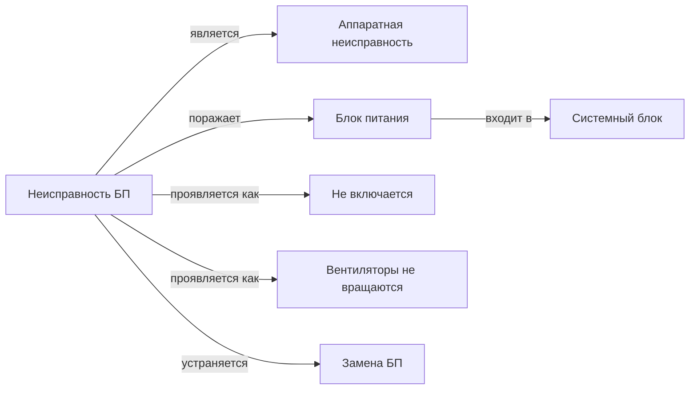

# Неделя 4. Репозиторий, предметная область, база знаний, семантическая сеть

## Задание
Создать GitHub-репозиторий. Выбрать предметную область. Создать базу знаний и семантическую сеть.

## Предметная область
**Диагностика неисправностей персонального компьютера.** Пользователь описывает признаки
(«не включается», «синий экран», «щёлкает диск»), система определяет вероятную неисправность,
объясняет вывод и даёт рекомендации по устранению.

Выбор обоснован тем, что область:
- хорошо формализуется: есть конечный набор признаков и неисправностей;
- естественно ложится на все модели представления знаний курса (логика, продукции, фреймы, сети);
- позволяет сгенерировать датасет для машинного обучения из вероятностей P(признак | неисправность).

## База знаний — `data/knowledge.json`
| Раздел | Кол-во | Содержимое |
|---|---|---|
| `components` | 18 | компоненты ПК, отношения `is_a` (является) и `part_of` (входит в) |
| `symptoms` | 20 | признаки: название, вопрос пользователю, шаблоны для распознавания текста |
| `faults` | 8 | неисправности: тип, компонент, опасность, априорная вероятность, P(признак \| неисправность), шаги устранения |

Код доступа к знаниям — `pcdoctor/knowledge_base.py` (класс `KnowledgeBase`):
загрузка, проверка целостности ссылок, обход иерархий `is_a`/`part_of`.

## Семантическая сеть — `pcdoctor/semantic_net.py`
Строится автоматически из базы знаний: **57 узлов, 103 дуги**.

Типы узлов: компонент, неисправность, признак, способ устранения, класс.
Отношения: `является` (is_a), `входит в` (part_of), `поражает` (affects),
`проявляется как` (manifests), `устраняется` (fixed_by).

Фрагмент сети (рисунок Mermaid) — [`docs/semantic_net.md`](../semantic_net.md).



## Запуск
```bash
python demos/week04_knowledge_base.py
python -m unittest tests.test_knowledge_base
```
