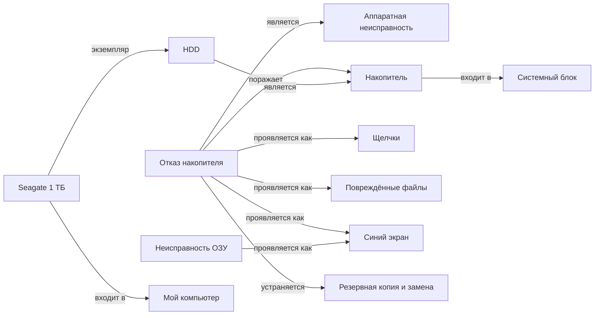

# Неделя 10. Семантическая сеть: узлы, связи, поиск

## Задание
Создать семантическую сеть. Добавить узлы и связи. Реализовать поиск связанных объектов.

## Сеть — `pcdoctor/semantic_net.py`
Сеть строится из базы знаний (неделя 4) и дополняется экземплярами из фреймовой модели (неделя 8):
**68 узлов, 124 дуги**.

| Тип узла | Кол-во | | Отношение | Кол-во |
|---|---|---|---|---|
| компонент (понятие) | 18 | | является (is_a) | 27 |
| экземпляр (конкретная деталь) | 11 | | входит в (part_of) | 23 |
| неисправность | 8 | | проявляется как (manifests) | 47 |
| признак | 20 | | поражает (affects) | 8 |
| способ устранения | 8 | | устраняется (fixed_by) | 8 |
| класс | 3 | | экземпляр (instance_of) | 11 |



## Поиск связанных объектов
| Метод | Что делает | Пример |
|---|---|---|
| `query(s, r, t)` | поиск по шаблону триплета, `None` — любое значение | `(?, manifests, bsod)` → 5 неисправностей |
| `related(node, depth)` | поиск в ширину: все узлы в радиусе N с путём до каждого | всё вокруг «Перегрева» |
| `find_path(a, b)` | кратчайшая цепочка связей между понятиями | «Щелчки» ↔ «Мой компьютер» |
| `generalizations / inherited_edges` | наследование по is_a/instance_of | Seagate входит в системный блок, потому что так входит любой HDD |
| `common(a, b)` | общие соседи | общие признаки ОЗУ и видеокарты |
| `activate(seeds)` | **распространение активации** с затуханием | признаки → ранжированный список неисправностей |

```
--- Распространение активации ---
   признаки: Артефакты на экране, Вылеты и зависания в играх, Сильный шум вентиляторов
   0.931  Неисправность видеокарты
   0.577  Проблема с драйверами
   0.577  Перегрев процессора
```

## Запуск
```bash
python demos/week10_semantic_net.py
python -m unittest tests.test_knowledge_base
```
